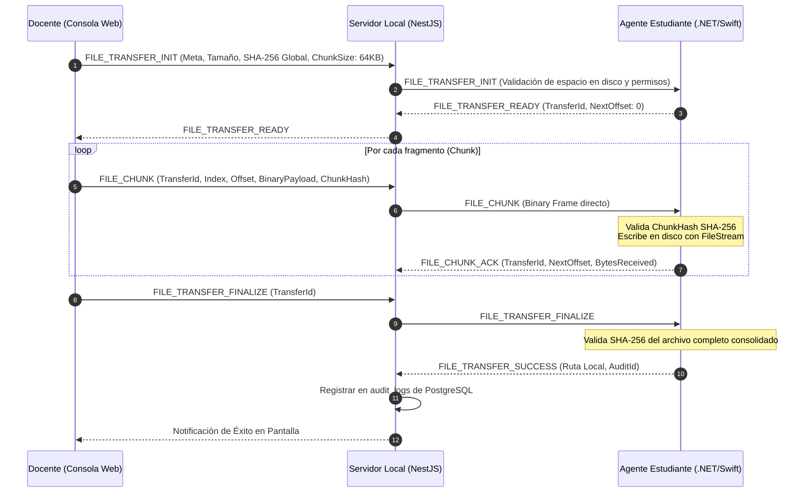

# ASSETSCHOOL — PROTOCOLOS DE RED, TRANSFERENCIA BINARIA Y CAPACIDAD
## Especificación de Wire Format, Streaming DTLS-SRTP y File Chunks (Fase 02.8)

- **Documento:** `docs/ASSETSCHOOL_NETWORK_PROTOCOLS.md`
- **Versión:** 1.0.0
- **Áreas:** Descubrimiento LAN, Canal WebSocket, WebRTC DTLS-SRTP, Transferencia Binaria de Archivos y Dimensionamiento de Red

---

## 1. PROTOCOLO DE DESCUBRIMIENTO LAN (UDP BROADCAST)

* **Puerto UDP**: `48500`
* **Dirección de Envío**: `255.255.255.255` y broadcasts dirigidos por interfaz (ej. `192.168.50.255`).
* **Frecuencia**: Intervalo fijo de 3000 ms.
* **Estructura del Paquete Wire (JSON Envelope)**:
  ```json
  {
    "protocolVersion": "1.0.0",
    "packetId": "d981c2f1-4b2e-48a1-b8d2-192a83910c22",
    "packetType": "DISCOVERY_BEACON",
    "senderId": "srv_macbook_lab01",
    "senderType": "server",
    "timestamp": 1731761000000,
    "payload": {
      "serverId": "srv_macbook_lab01",
      "serverVersion": "1.0.0",
      "serverHost": "192.168.50.60",
      "httpPort": 3000,
      "wsPort": 3000,
      "wsPath": "/socket.io",
      "institutionId": "aaaaaaaa-aaaa-aaaa-aaaa-aaaaaaaaaaaa",
      "institutionCode": "CPC-01",
      "institutionName": "Instituto Politécnico Central",
      "tlsFingerprintSha256": "3B:4A:22:...:9C"
    }
  }
  ```

### 1.1. Manejo Multisubred y Redes con VLANs
En infraestructuras escolares donde las computadoras de los estudiantes se encuentran en una VLAN (`192.168.60.0/24`) y el servidor del profesor en otra (`192.168.50.0/24`), los broadcasts de Layer 2 son bloqueados por los switches/routers.
* **Solución de Red 1 (IP Helper / UDP Relay)**: Habilitar `ip forward-protocol udp 48500` en el switch central para retransmitir la baliza entre VLANs del laboratorio.
* **Solución de Red 2 (Unicast Directo de Respaldo)**: Los agentes instalados permiten configurar una IP o nombre DNS estático (`--server-host aula-profesor.lan:3000`) cuando el descubrimiento UDP está deshabilitado por política de red.

---

## 2. PROTOCOLO BINARIO DE TRANSFERENCIA DE ARCHIVOS POR CHUNKS (CHUNKED PROTOCOL)

Para evitar la sobrecarga de memoria del protocolo JSON Base64 actual al enviar archivos pesados (videos de clase, instaladores o imágenes ISO de 500 MB a 2 GB), se especifica el **Protocolo de Chunks Binarios de AssetSchool**:



### 2.1. Parámetros Técnicos del Protocolo de Chunks
* **Tamaño Máximo de Archivo**: 4 GB (`4,294,967,296 bytes`).
* **Tamaño Estándar de Fragmento**: `64 KB` (65,536 bytes) para enlaces Wi-Fi; `256 KB` (262,144 bytes) para enlaces Gigabit Ethernet cableados.
* **Integridad Criptográfica**:
  * **Checksum por Fragmento**: SHA-256 del chunk recibido para descarte y reintento inmediato sin perder el resto del archivo.
  * **Checksum Global**: SHA-256 del archivo completo verificado antes de marcar el archivo como disponible.
* **Control de Flujo y Memoria (Backpressure)**:
  * El agente utiliza un buffer de escritura en streaming (`FileStream` con buffer de 128 KB en C# / `OutputStream` en Swift).
  * Límite de consumo de memoria RAM en el agente durante la transferencia: **< 15 MB de RAM constante**, sin importar el tamaño del archivo transferido.
* **Manejo de Interrupciones y Reanudación (Resume)**:
  * Cada paquete `FILE_CHUNK_ACK` confirma el `BytesReceived`.
  * Si la conexión Wi-Fi se corta durante la transferencia, al reconectar el docente envía `FILE_TRANSFER_RESUME` con el `TransferId`; el agente responde con el último byte guardado y la transferencia continúa desde ese punto exacto.
* **Protección Estricta contra Path Traversal**:
  ```csharp
  // Validación estricta en el Agente de Windows
  string safeBasePath = Path.GetFullPath(Path.Combine(Environment.GetFolderPath(Environment.SpecialFolder.UserProfile), "Downloads", "AssetSchool"));
  string destinationPath = Path.GetFullPath(Path.Combine(safeBasePath, sanitizedFileName));

  if (!destinationPath.StartsWith(safeBasePath, StringComparison.OrdinalIgnoreCase))
  {
      throw new SecurityException("Intento de violación de Path Traversal bloqueado por el agente.");
  }
  ```

---

## 3. STREAMING DE PANTALLA WEBRTC Y DIMENSIONAMIENTO DE CAPACIDAD

Para evitar afirmaciones irreales, se diferencia estrictamente entre los diferentes estados de carga del aula:

```
[Equipos Registrados en BD] >= [Agentes Conectados en TCP] >= [Agentes Autenticados] >= [Sesiones WebRTC Listas] >= [Flujos de Video Activos]
```

### 3.1. Niveles de Calidad Adaptativa (Dynamic Quality Tiers)
1. **Tier Mosaico (Thumbnail Mode - Supervisión Simultánea)**:
   * **Resolución**: `640 x 360` (16:9).
   * **Tasa de Cuadros**: `5 - 10 FPS`.
   * **Bitrate Objetivo**: `150 - 250 kbps` por equipo.
   * **Uso**: Vista de mosaico completa con 10, 20 o 40 alumnos en pantalla simultáneamente.
2. **Tier Individual (Focus Inspection Mode - Vista Detallada)**:
   * **Resolución**: `1920 x 1080` (Full HD).
   * **Tasa de Cuadros**: `30 - 60 FPS`.
   * **Bitrate Objetivo**: `1,500 - 3,000 kbps`.
   * **Uso**: Activado exclusivamente cuando el profesor hace clic en un estudiante específico para inspeccionar su trabajo o tomar el control remoto.

### 3.2. Objetivos de Capacidad y Rendimiento por Tamaño de Aula

| Métrica de Red y Sistema | Aula Pequeña (10 PCs) | Aula Mediana (20 PCs) | Aula Completa (40 PCs) |
| :--- | :---: | :---: | :---: |
| **Agentes Conectados al Servidor** | 10 | 20 | 40 |
| **Ancho de Banda LAN en Mosaico (10 FPS)** | **~2.5 Mbps** | **~5.0 Mbps** | **~10.0 Mbps** |
| **Ancho de Banda con 1 Inspección 1080p Activa** | **~4.5 Mbps** | **~7.0 Mbps** | **~12.0 Mbps** |
| **Consumo de RAM en Servidor Docente (NestJS)** | ~60 MB | ~85 MB | ~140 MB |
| **Uso de CPU en el Servidor (Solo Señalización)** | < 3% | < 5% | < 8% |
| **Uso de CPU en cada PC Alumno (Captura GPU)** | < 4% | < 4% | < 4% |
| **Tecnología de Switch Recomendada** | Wi-Fi 5 / 100 Mbps | Wi-Fi 6 / 100 Mbps Switch | Switch Gigabit 1 Gbps dedicado |

> [!IMPORTANT] Conclusión de Ingeniería sobre 40 Clientes
> Sostener 40 transmisiones simultáneas a 1080p Full HD saturaría cualquier tarjeta de red y colapsaría el navegador del docente. El estándar de la industria (NetSupport / LanSchool) y la arquitectura de AssetSchool resuelven esto enviando **miniaturas ligeras a 10 FPS (10 Mbps en total para las 40 máquinas)** y elevando a 1080p únicamente el equipo que el docente esté observando en detalle.
