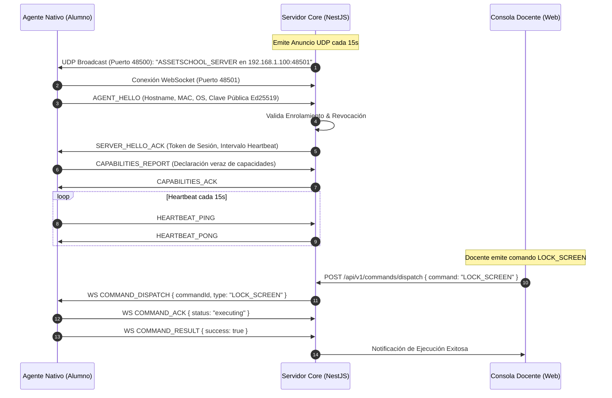

# AssetSchool — Arquitectura de Red y Protocolo LAN

## 1. Topología de Red y Filosofía LAN-First
AssetSchool opera íntegramente en la red de área local del centro educativo. Todo el tráfico de control, vídeo en tiempo real y transferencia de archivos permanece dentro del perímetro físico de la red del colegio.

## 2. Puertos y Protocolos Utilizados

| Protocolo | Puerto | Destino | Uso |
| :--- | :--- | :--- | :--- |
| **UDP Broadcast** | `48500` | `255.255.255.255` o Subred Broadcast | Anuncio periódico de descubrimiento zero-config del servidor local |
| **TCP / WebSocket (WSS)** | `48501` | Servidor Core | Canal de comando y control bidireccional permanente con los agentes |
| **TCP / HTTP(S)** | `3000` | Servidor Core | API REST consumida por consolas web docente y administrativa |
| **TCP / HTTP(S)** | `5173` / `80` | Servidor Web | Alojamiento de la consola web del profesor |
| **UDP WebRTC** | `49152-65535` | P2P entre Profesor y Alumnos | Streaming de pantalla a 60 FPS con códecs H.264/VP9 sobre LAN |

## 3. Resiliencia ante Segmentación de VLANs
En instituciones con aislamiento de broadcast entre VLANs de alumnos y profesores, los agentes admiten aprovisionamiento por DNS estático local (`assetschool-server.lan`) o mediante variable de entorno `ASSETSCHOOL_SERVER_IP`.
