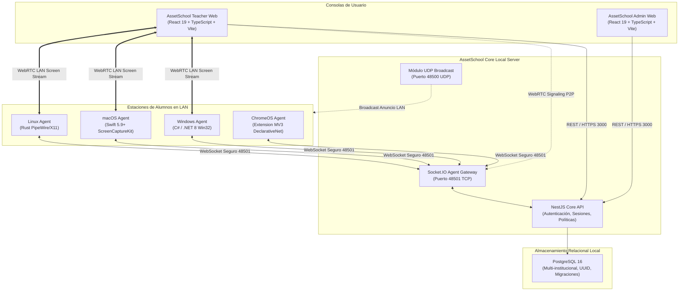

# AssetSchool — Arquitectura General del Sistema

## 1. Visión y Propósito
**AssetSchool** es una solución de gestión, supervisión y control de aulas informáticas diseñada con un enfoque **LAN-first**: opera con latencia ultrabaja dentro de la red local del colegio o universidad, sin depender de conectividad a la nube o servicios de terceros (como Firebase o Supabase).

## 2. Diagrama de Bloques Arquitectónicos

## 3. Componentes Principales

### 3.1. AssetSchool Teacher & Admin (Frontend Web)
- **Tecnologías**: React 19, TypeScript, Vite, Tailwind CSS, Lucide Icons, React Router v7.
- **Responsabilidad**: Interfaz moderna, reactiva, accesible y con soporte para modo claro/oscuro. Ofrece monitorización simultánea de pantallas en cuadrícula, emisión de directivas pedagógicas (bloqueo, transmisión de pantalla, control de procesos), administración de salas, cursos y estudiantes.

### 3.2. AssetSchool Core (Backend Servidor Local)
- **Tecnologías**: Node.js v24, NestJS 10, REST API, WebSocket (Socket.IO), JWT, Bcrypt.
- **Responsabilidad**: Servidor centralizado local. Gestiona la autenticación institucional con control de acceso basado en roles (RBAC), control del ciclo de vida de sesiones de aula, registro criptográfico de dispositivos y enrutamiento seguro de comandos hacia los agentes.

### 3.3. Base de Datos (PostgreSQL 16)
- Modelo relacional íntegro con 19 entidades, UUIDs nativos, restricciones foráneas, índices de alto rendimiento y segregación por institución educativa.

### 3.4. Agentes Nativos Multiplataforma
- Implementados en lenguajes nativos compilados optimizados para su respectivo sistema operativo, respetando estrictamente los modelos de seguridad de cada plataforma sin simular características imposibles.
