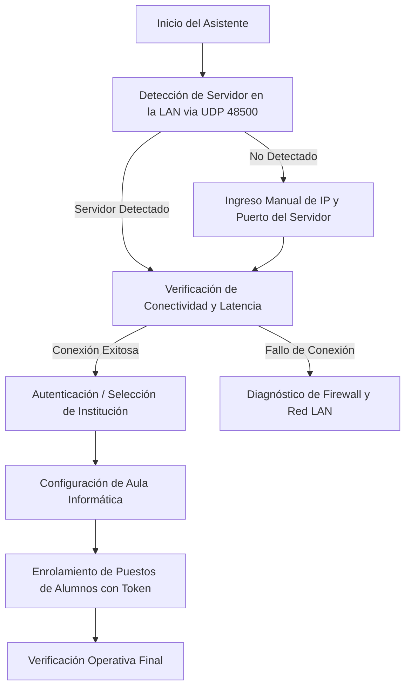

# GUÍA DE CONFIGURACIÓN INICIAL (ASSETSCHOOL SETUP WIZARD)

Esta guía orienta al administrador TIC o docente en el primer inicio de **AssetSchool Master** o tras la instalación del servidor.

---

## 1. FLUJO DEL ASISTENTE DE CONFIGURACIÓN INICIAL

---

## 2. PASO A PASO DE LA CONFIGURACIÓN

### Paso 1: Detección del Servidor en la Red Local
- AssetSchool Master escucha activamente el puerto `UDP 48500` para detectar la baliza de presencia emitida por AssetSchool Server cada 3 segundos.
- Si el servidor se encuentra en otra subred o VLAN educativa, ingrese la dirección IP estática del servidor (ej: `http://192.168.10.5:3000`).

### Paso 2: Validación de Conectividad y Latencia
- El asistente realiza un ping HTTP a `/api/v1/health`.
- Valida la compatibilidad de versiones entre Master y Server.
- Informa la latencia de respuesta en milisegundos.

### Paso 3: Selección o Registro Institucional
- Inicie sesión con credenciales de `INSTITUTION_ADMIN` o `DIRECTOR`.
- Si es una instalación nueva, complete los datos institucionales:
  - Nombre del Establecimiento Educacional.
  - RUT Institucional.
  - Región y Comuna.
  - Correo electrónico y teléfono de contacto TIC.

### Paso 4: Configuración de Aula y Puestos
- Seleccione el laboratorio informático asignado al aula.
- Para enrolar los computadores de los estudiantes de forma desatendida:
  1. Genere un **Token de Enrolamiento** en la sección *Enrolamiento de Equipos*.
  2. Defina el cupo máximo de equipos (ej: 40 puestos) y horas de vigencia (ej: 24 horas).
  3. Proporcione este token en el script de instalación de los estudiantes (`ENROLLMENT_TOKEN="ENROLL-XXXXXX"`).
  4. Los equipos enrolados aparecerán en la lista para su aprobación final.

### Paso 5: Prueba de Transmisión WebRTC
- Inicie una sesión de prueba en el panel docente para validar la inicialización de los workers C++ de Mediasoup SFU y la recepción de miniaturas de pantalla.
