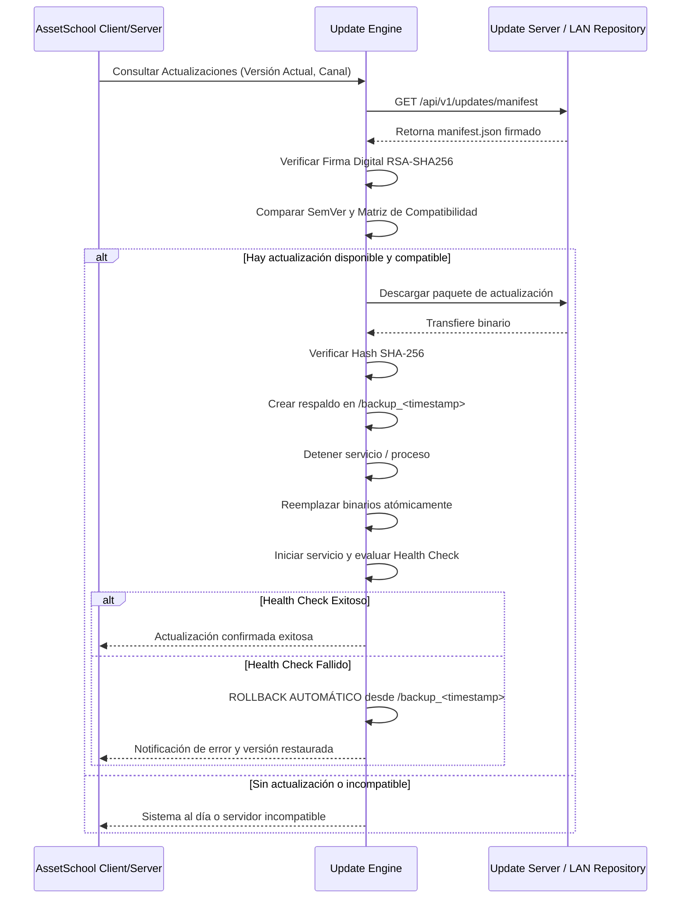

# ARQUITECTURA DEL SISTEMA DE ACTUALIZACIONES (ASSETSCHOOL)

AssetSchool implementa un motor de actualización transaccional de alta seguridad diseñado para operar en redes educativas locales y entornos institucionales.

---

## 1. PRINCIPIOS DE SEGURIDAD DEL MOTOR DE ACTUALIZACIÓN

1. **Autenticidad Criptográfica Estricta:** Ningún binario, paquete o actualización se ejecuta o reemplaza sin haber validado su firma digital asimétrica (RSA-SHA256) contra la clave pública del vendor.
2. **Integridad de Contenido:** Se calcula el hash SHA-256 del paquete descargado y se contrasta contra el manifiesto oficial firmado.
3. **Respaldo Previo Obligatorio:** Antes de modificar cualquier archivo de la aplicación, el motor genera una copia íntegra de la versión actual (`backup_<timestamp>`).
4. **Verificación de Salud Posterior:** La nueva versión es ejecutada y evaluada mediante comprobaciones de salud del servicio (health check).
5. **Rollback Automático Transaccional:** Si la nueva versión no responde o falla las pruebas iniciales, el motor revierte de inmediato los binarios a la versión de respaldo sin intervención del usuario.
6. **Matriz de Compatibilidad:** Los clientes Master y Student verifican la propiedad `minServerVersion` del manifiesto para impedir actualizar a una versión que el servidor de la escuela no pueda atender.

---

## 2. ESTRUCTURA DEL MANIFIESTO DE VERSIONES (`manifest.json`)

```json
{
  "version": "1.2.1",
  "channel": "stable",
  "releaseDate": "2026-11-18T18:00:00Z",
  "minServerVersion": "1.0.0",
  "releaseNotes": "Optimizaciones de estabilidad en captura ScreenCaptureKit y menor consumo CPU en Windows DXGI.",
  "packages": {
    "macos-arm64": {
      "url": "http://192.168.1.50:3000/updates/AssetSchool-1.2.1-arm64.pkg",
      "sha256": "e3b0c44298fc1c149afbf4c8996fb92427ae41e4649b934ca495991b7852b855",
      "sizeBytes": 12451840
    },
    "windows-x64": {
      "url": "http://192.168.1.50:3000/updates/AssetSchool-1.2.1-x64.msi",
      "sha256": "ca978112ca1bbdcafac231b39a23dc4da786eff8147c4e72b9807785afee48bb",
      "sizeBytes": 18239488
    }
  },
  "signature": "3a8f102c98...[FIRMA RSA-SHA256 DEL VENDOR]..."
}
```

---

## 3. CANALES DE DISTRIBUCIÓN

- **`stable`:** Canal predeterminado para producción institucional. Recibe únicamente versiones que han superado todas las suites de validación E2E.
- **`beta`:** Canal de pruebas para establecimientos con programa de adopción temprana. Permite validar nuevas características antes del despliegue masivo en el colegio.

---

## 4. FLUJO TRANSACCIONAL DE ACTUALIZACIÓN


