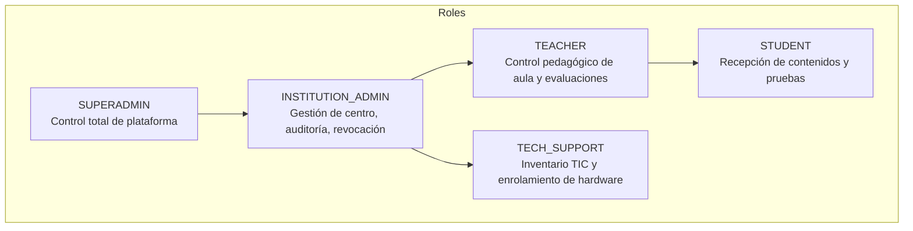

# AssetSchool — Modelo de Seguridad Institucional y Ética

## 1. Principios de Diseño
AssetSchool fue concebido bajo el principio de **Supervisión Pedagógica Consentida y Visible**. No es una herramienta de espionaje ni software espía (spyware).

### Reglas Inquebrantables de Seguridad:
1. **Sin Keylogging**: Queda expresamente prohibida la captura indiscriminada de pulsaciones de teclas o passwords.
2. **Sin Cámaras Web Ocultas**: No se permite la activación de webcams ni micrófonos en segundo plano sin indicador visual en pantalla.
3. **Visibilidad para el Estudiante**: Cuando una pantalla es observada o controlada, el agente del estudiante muestra un indicador visual en el área de notificación del sistema.
4. **Trazabilidad Total**: Toda directiva emitida por un profesor o administrador genera un registro de auditoría inmutable con su identidad, IP y timestamp.

## 2. Identidad Criptográfica de Dispositivos (Device Identity)
- Cada agente genera en su primer arranque un par de claves asimétricas **Ed25519**.
- Durante el registro (`AGENT_REGISTER`), la clave pública queda vinculada al UUID del dispositivo y a su dirección física MAC.
- Las órdenes de control enviadas por el servidor viajan firmadas con tokens de sesión criptográficos efímeros.

## 3. Matriz de Control de Acceso Basada en Roles (RBAC)

| Permiso | SUPERADMIN | INSTITUTION_ADMIN | TEACHER | TECH_SUPPORT | STUDENT |
| :--- | :---: | :---: | :---: | :---: | :---: |
| `institution:manage` | **Sí** | No | No | No | No |
| `user:create / edit` | **Sí** | **Sí** | No | No | No |
| `classroom:manage` | **Sí** | **Sí** | No | No | No |
| `device:revoke` | **Sí** | **Sí** | No | **Sí** | No |
| `session:start / end` | **Sí** | **Sí** | **Sí** | No | No |
| `device:lock / control` | **Sí** | **Sí** | **Sí** | No | No |
| `assessment:launch` | **Sí** | **Sí** | **Sí** | No | No |
| `audit:view` | **Sí** | **Sí** | No | **Sí** | No |
| `assessment:view` | **Sí** | **Sí** | **Sí** | No | **Sí** |

## 4. Almacenamiento Seguro de Credenciales
- Ninguna contraseña se almacena en texto plano. Se utiliza **Bcrypt** con factor de costo configurable (`saltRounds = 10`).
- Tokens JWT firmados con algoritmo HS256 o RS256 con tiempo de expiración limitado a la jornada académica (8 horas).
